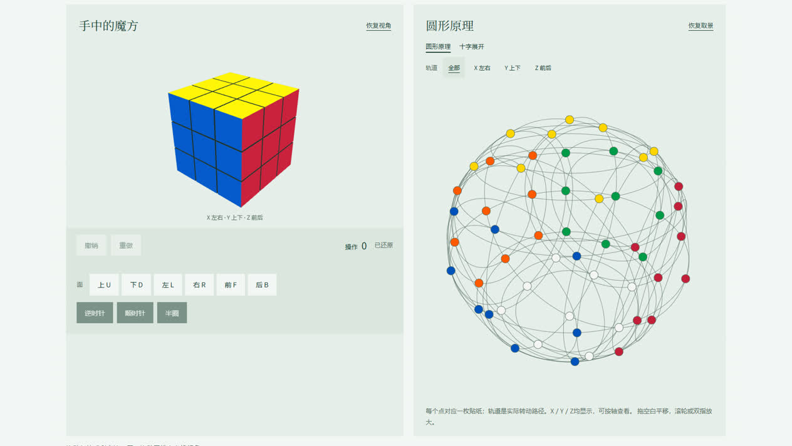

# 图论与魔方

把一次转层同时放在三维魔方、圆形轨道与十字展开图中观察。沿用「花前月下」博客的浅绿／深绿主题，支持电脑和手机操作。

**[打开在线体验 →](https://hqyx.website/rubiks-cube/)** · [项目介绍](https://hqyx.website/projects/rubiks-cube) · [博客「在线体验」分类](https://hqyx.website/projects?kind=experience)



## 本次更新

- 统一提供2～7阶、内层与任意连续多层、自由视角；已取消简单／进阶切换，旧存档局面、历史和视角继续保留。
- 操作面板可收起／展开，折叠后仍保留计时与上一步提示；面按钮、撤销重做及内层／多层范围控制一起折叠，直接拖动和键盘继续可用。
- 练习计时支持开始、暂停、继续、结束及重新计时；刷新恢复暂停状态，进入公式示例自动暂停。新开局先确认并清零计时，暂停时间不计入用时。
- 按住色块或彩点，方向明确后连续跟手转动，松手归位；一次最多转 180°。快速甩动可推进一格。
- 三种视图共用同一份贴纸状态。每个圆点对应一枚贴纸（3 阶 54 点、7 阶 294 点）；轨道由真实轴向旋转计算，并投影到平面，默认显示全部轨道，也可按 X／Y／Z 筛选。轴上的固定点另作标记。
- 三维与二维同步动画；二维可独立平移缩放，轨道图和展开图均可直接拖动转层。
- 撤销、重做、可展开的步骤记录与动画回看；整次打乱可一次撤销。
- 三阶按Cross／F2L／OLL／PLL分类，包含41种F2L、57种OLL、21种PLL，并保留原有35个算法和十字指导；支持阶数、阶段、分组和名称／公式搜索。
- 四阶提供中心、合棱、降阶CFOP及OLL／PLL特殊情况的13个算法示例，明确区分`2R`内层与`Rw`宽层。各阶段有识别、拿法和讲解；每个示例有模型生成局面图与逐步中文转动说明。
- 公式支持播放、暂停、前后单步、「回到第一步」暂停及自动「重新播放」。默认使用对应三阶／四阶的独立示例，退出恢复原局；主动应用仅限同阶局面。资料与记号见 [说明](./rubiks-cube/FORMULAS.md)。
- 浏览器本机保存局面、历史、视角与偏好，刷新继续；提供深浅主题和动画速度设置。
- 播放中也可回到第一步或重播；退出独立演示恢复进入前的局面、历史、视角、多层范围、偏好及上一步提示，练习计时保持暂停，由用户继续。
- 常驻「上一步」提示记录用户自己转动的面／层、方向和角度，撤销、重做和打乱也有提示；只换视角或取消拖动不覆盖上次转动。默认优先归位90°，明确拖到160°才会归位180°，快速甩动不会把普通一格推进成半圈。
- 公式提供0.25／0.5／0.75／1／1.25／1.5倍速，播放中平滑切换，退出和刷新后记住选择。演示播放或暂停时可直接拖动三维换视角、滚轮／双指缩放，以及平移二维图；观察不会改变公式步骤，退出仍恢复原局视角。
- 左右默认绘图区等宽等高，三维与圆形图的显示占比接近。「沉浸体验」进入浏览器全屏，可选择双视图、仅左侧三维或仅右侧二维，所有模式保留必要操作与公式控制；按钮或Esc退出。设备不支持原生全屏时铺满浏览器视口，小屏内容可滚动。
- 公式演示以双框持续高亮目标物理块，三维、圆形图与展开图同步跟踪；F2L同时标出目标角块和棱块，并显示颜色、目标槽位及已归位数量。OLL单独判断朝向，四阶特例高亮翼棱；完成后保留标记，退出后清除。

## 在本机运行

需要 Node.js 24 或更新版本，无需安装依赖：

```sh
git clone https://github.com/hqyx2025/Rubik-s-Cube.git
cd Rubik-s-Cube
npm start
```

打开终端显示的 `http://localhost:8080/rubiks-cube/`。自定义端口可用 `node scripts/serve.mjs 8094`。请通过 HTTP 访问，直接双击 HTML 会受到 ES module 和 JSON 请求限制。

也可以用任意静态服务器提供仓库根目录，访问 `/rubiks-cube/`。页面中的博客导航会打开线上博客。本仓库不包含博客后端、数据库或账号数据。

## 操作

| 操作 | 电脑 | 手机 |
| --- | --- | --- |
| 拧一层 | 左键拖色块／二维彩点 | 单指拖色块／二维彩点 |
| 调整三维视角 | 拖空白或右键拖动 | 拖空白；双指换视角与缩放 |
| 调整二维取景 | 拖空白平移，滚轮缩放 | 拖空白平移，双指平移缩放 |
| 多层 | 展开操作面板，开启「多层模式」，先选连续范围 | 同左 |

第二根手指落下时，未完成的单指转层会平滑取消，再接管双指操作。观看视角可自由翻转。更完整的说明见页面「操作说明」。

## 验证与结构

```sh
npm test
```

测试覆盖 2～7 阶所有轴与连续层范围、正逆转一致性、轨道覆盖与动画中间点、三四阶公式解析、完整CFOP情况与前置条件、四阶特例、历史回退、恢复校验和长历史检查点。参见 [实现说明](./docs/implementation.md)。

```text
rubiks-cube/       页面、控制器、精确贴纸模型、三种视图及本地 Three.js
fonts/            博客共用字体及 OFL 许可
style.css         博客共用样式
test/             模型与会话测试
scripts/serve.mjs  仅绑定本机的开发静态服务器
```

本轮不包含任意局面自动求解、账号／云同步、计时榜或声音震动。存档保存在各浏览器对应站点，本机预览和线上体验不会自动共享存档。正式服务器继续承载博客「在线体验」分类；该分类收录具有直接操作入口的作品。

## 灵感与许可

圆形轨道表达参考用户提供的 [GeoMath《二维平面魔方原理解析》](https://www.douyin.com/video/7661035183231947002)。在该参考基础上独立实现贴纸映射、轨迹计算与交互，不主张发明原始表达或认定参考发布者为最早发明者。

项目沿用 [Apache License 2.0](./LICENSE)，修改说明见 [NOTICE](./rubiks-cube/NOTICE.txt)。Three.js 为 MIT 许可，字体许可见 `fonts/`。
